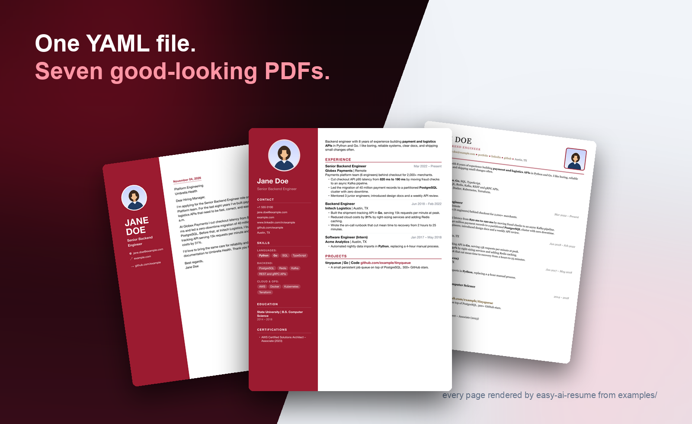
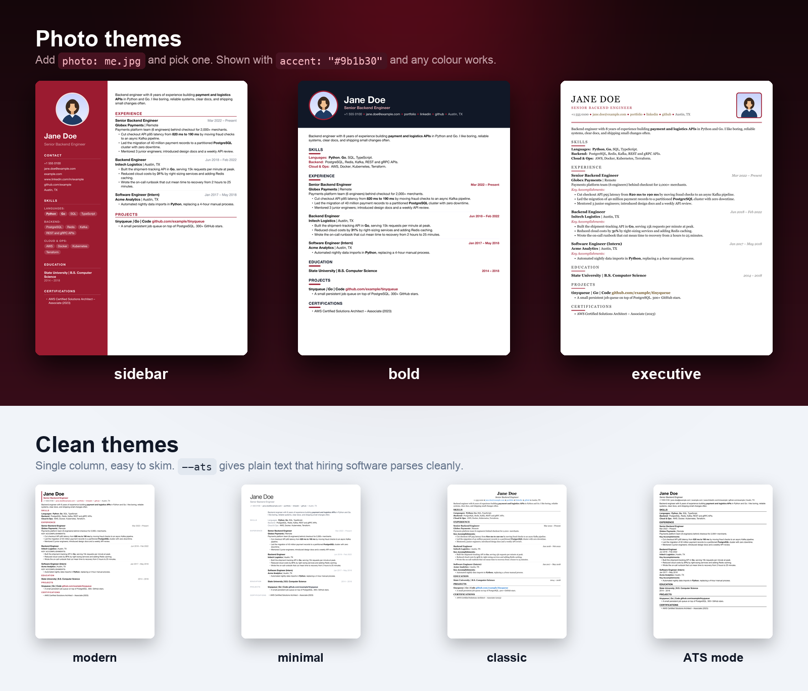

<p align="center">
  
</p>

<p align="center">
  <a href="https://github.com/whoisadityaj/easy-ai-resume/actions/workflows/ci.yml"></a>
  <a href="LICENSE"></a>
  
</p>

<h1 align="center">easy-ai-resume</h1>

<p align="center">
  <b>Your resume, made easy.</b> One text file in, a clean PDF out.<br>
  AI tailors it to each job, and a fact check stops it <b>inventing anything</b>.
</p>

<p align="center">
  
</p>

<p align="center">
  
</p>

## 🧭 Get started

### 1. Install (once)

**Mac** (needs [Homebrew](https://brew.sh)):

```bash
brew install uv pango
uv tool install "easy-ai-resume[ai] @ https://github.com/whoisadityaj/easy-ai-resume/archive/refs/tags/v0.8.0.zip"
```

- **Ubuntu / Debian:** `sudo apt install libpango-1.0-0 libpangoft2-1.0-0`, install [uv](https://docs.astral.sh/uv/getting-started/installation/), then the `uv tool install` line.
- **Windows:** install [uv](https://docs.astral.sh/uv/getting-started/installation/) and [Pango](https://doc.courtbouillon.org/weasyprint/stable/first_steps.html#windows), then the `uv tool install` line.
- uv installs Python for you. `command not found`? Run `uv tool update-shell` and open a new terminal.
- **Update later:** run the `uv tool install` line again with the newer version and `--force`.

### 2. Add your details

```bash
mkdir my-cv && cd my-cv
easy-ai-resume init
```

This makes `input/` with a sample `cv.yaml`, `cover_letter.yaml`, `job.md` and photo. Replace the sample details with yours:

```yaml
name: Your Name                  # "label: value", one per line
experience:
  - role: Senior Designer        # "-" starts a list item
    company: Your Company        # indent with 2 spaces, never Tab
    start: Jan 2022
    end: Present
    bullets:
      - Led the redesign of the **checkout page**   # **text** = bold
```

Delete sections you don't need. Quote values containing `:` or `#`: `title: "Lead: Platform"`.

### 3. Make your PDFs and pick a look

```bash
easy-ai-resume build                                      # PDFs in output/
easy-ai-resume build --theme sidebar                      # try a theme: photo + colour panel
easy-ai-resume build --theme sidebar --accent "#9b1b30"   # same theme in red
easy-ai-resume build --ats                                # plain version for job portals
```

Like one? Put it in **both** `input/cv.yaml` and `input/cover_letter.yaml` so plain `build` uses it:

```yaml
theme: sidebar
accent: "#9b1b30"   # any hex colour; without it each theme uses its own default
photo: me.jpg       # put the photo in input/ (photo themes only); `photo: none` for no photo
page: a4            # a4, letter, legal, single, single-tall, or a CSS size like "210mm 380mm"
```

In the cover letter, `photo:` goes under `sender:`. All themes are [below](#-themes).

### 4. Tailor to a job (optional, uses AI)

Paste the job post into `input/job.md`, then:

```bash
export ANTHROPIC_API_KEY=your-key                # once per terminal (Windows: $env:ANTHROPIC_API_KEY="your-key")
easy-ai-resume tailor input/job.md --build       # add --ats or --theme sidebar for that look
```

Get a key at [console.anthropic.com](https://console.anthropic.com) (or use OpenAI: `OPENAI_API_KEY` and `--model`).
Each run costs a little API credit. `build` never uses AI and works without a key.

```text
my-cv/
├── input/      ← cv.yaml, cover_letter.yaml, job.md, photo (you edit these)
├── output/     ← standard PDFs
└── tailored/   ← one folder per job: tailored YAML + PDFs
```

**More jobs:** one file per job post in `input/`, e.g. `input/acme.md` → `tailored/acme/`.

**How tailoring works, in plain words:**

1. **AI step.** Your `cv.yaml`, `cover_letter.yaml` and the job post are sent to the AI (Claude by default).
   It returns a reworded *copy*: the most relevant experience first, bullets that don't fit dropped, the job's
   words used where you really have that experience, and a cover letter written for that company. It is told never
   to add facts. Your files in `input/` are never changed.
2. **Fact check (no AI, plain code).** easy-ai-resume compares the copy with your originals and warns about
   anything new or changed: numbers, dates, employers, job titles, schools, skills in your skills list, projects
   and contact details.
3. **You review.** It prints `diff` commands that show every change. Fix anything wrong in the tailored YAML,
   then rebuild with `easy-ai-resume build tailored/job/*.yaml --out tailored/job`.

```text
Check these before sending (possible invented or changed facts):
  - numbers not in your originals (check metrics): 65%
  - skills not in original: rust
```

The fact check can't judge meaning ("helped with" becoming "led"), so always read the diff before sending.

## 🎨 Themes

<p align="center">
  
</p>

The pictures use `accent: "#9b1b30"`. Without `accent:`, each theme uses the default colour below.

| Theme | Look | Photo | Default colour |
|---|---|:---:|---|
| `sidebar` | Two columns, colour panel with photo and skill chips | ✅ | navy `#1e3a5f` |
| `bold` | Dark header band, accent headings | ✅ | purple `#7c3aed` |
| `executive` | Refined serif, accent rules | ✅ | gold `#a67c37` |
| `modern` | Sans-serif, accent colour | ❌ | blue `#2563eb` |
| `minimal` | Light type, labels in the margin | ❌ | near-black `#111827` |
| `classic` (default) | Serif, centred header | ❌ | red-orange `#d24f3a` (cover letter) |
| `compact` | Smaller type, fits more on a page | ❌ | red-orange `#d24f3a` (cover letter) |

No PDF because Pango won't install? `easy-ai-resume build --html-only`, open the HTML file in a browser, **Print → Save as PDF**.

## 🤖 ATS mode (for job portals)

Most job portals run your PDF through an **ATS** (applicant tracking system, like Workday, Greenhouse or Lever).
It pulls the text out of your PDF to fill a form and to search for keywords. Columns, icons and colour panels can
scramble that text. `--ats` (or `ats: true` in the YAML) makes a version that reads cleanly:

- one column, so the text comes out top to bottom in the right order
- standard headings (Skills, Experience, Education, Projects)
- a common font (Arial), black text, no photo, icons or colour panels
- full links (`linkedin.com/in/you`) instead of the word "linkedin"
- real text, not an image (true for every theme)

Use `--ats` when you upload to a portal, and a styled theme when you email a person. ATS mode doesn't add
keywords or give a score: matching the job's wording is what `tailor` does.

**Check it yourself:** open the PDF, select all, copy and paste into a text editor. If it reads in order, an ATS
can read it. Try the same with `sidebar` and you'll see the two columns mixed together.

## ⚙️ Commands and options

| Command | What it does |
|---|---|
| `easy-ai-resume init` | Creates `input/` with sample files to edit. Never overwrites (`--force` resets them). |
| `easy-ai-resume build` | Makes PDFs from `input/cv.yaml` and `input/cover_letter.yaml` in `output/`. |
| `easy-ai-resume build some/file.yaml` | Builds just that file, e.g. a tailored copy you edited. |
| `easy-ai-resume tailor input/acme.md` | Makes an AI-tailored copy for that job in `tailored/acme/`. Add `--build` for the PDFs. |

| Option | Works with | What it does |
|---|---|---|
| `--theme sidebar` | build, tailor | Use this theme for this run |
| `--accent "#9b1b30"` | build, tailor | Use this colour for this run |
| `--ats` | build, tailor | Plain ATS-friendly PDFs |
| `--page-size a4` | build | a4, letter, legal, single, single-tall, or a CSS size |
| `--out folder` | build, tailor | Write the files somewhere else |
| `--html-only` / `--html` | build | Write an HTML file instead of / as well as the PDF |
| `--provider openai --model <name>` | tailor | Use OpenAI instead of Claude |
| `--force` | init, tailor | Overwrite files from an earlier run |
| `--strict` | tailor | Exit with code 2 when the fact check warns (for scripts) |

`easy-ai-resume build --help` and `easy-ai-resume tailor --help` list everything.

- **Other file names:** add `easy-ai-resume.yaml` to `my-cv/`. Every line is optional:

  ```yaml
  cv: input/resume.yaml       # default: input/cv.yaml
  letter: input/letter.yaml   # default: input/cover_letter.yaml
  output: pdfs                # default: output
  tailored: jobs              # default: tailored
  build: true                 # tailor always makes PDFs, no --build needed
  ```

- **GitHub Action:** keep `my-cv/` in a private repo and copy [`examples/github-workflow.yml`](examples/github-workflow.yml)
  to `.github/workflows/cv.yml`. Every push rebuilds your PDFs.
- **All YAML fields:** see the samples `init` creates (also in [examples/](examples/)). Every section is optional.

## License

[MIT](LICENSE). If it helps you land an interview, a ⭐ helps the next person find it.
