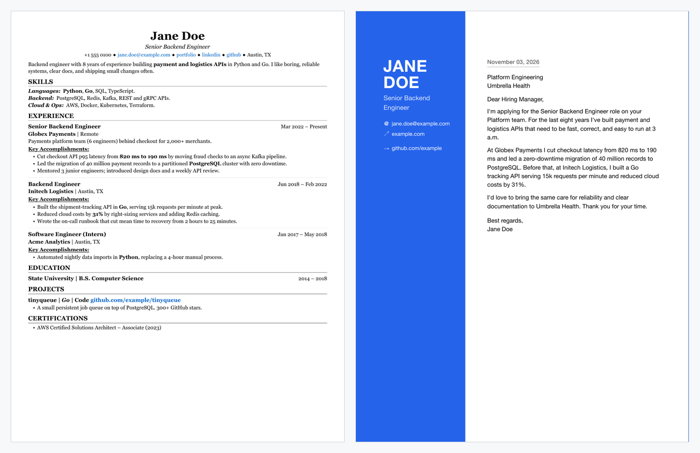
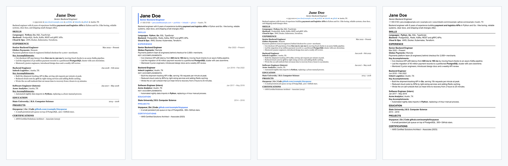

<p align="center">
  
</p>

<p align="center">
  <a href="https://github.com/whoisadityaj/cv-as-code/actions/workflows/ci.yml"></a>
  <a href="LICENSE"></a>
  
  
</p>

<h1 align="center">cv-as-code</h1>

<p align="center">
  <b>Your CV as code.</b> Write it once in YAML, get a clean PDF,<br>
  and tailor it to any job with AI, <b>without the AI making things up</b>.
</p>

<p align="center">
  <a href="#quickstart">Quickstart</a> ·
  <a href="#themes">Themes</a> ·
  <a href="#tailor-to-a-job-with-ai">AI tailoring</a> ·
  <a href="#build-in-github-actions">GitHub Action</a>
</p>

<p align="center">
  
</p>

## What you get



- **YAML in, PDF out.** Plain text you can diff, review and keep in Git.
- **3 themes + ATS mode.** Classic, modern and compact, plus a plain layout that
  applicant-tracking systems parse cleanly.
- **AI tailoring with a fact check.** Rewords your CV and cover letter for a job description, then
  flags any number, date, employer, school or skill that wasn't in your original.
- **Runs in GitHub Actions.** Push your YAML, get fresh PDFs.

## Quickstart

```bash
pip install git+https://github.com/whoisadityaj/cv-as-code
cv-as-code build examples/cv.yaml examples/cover_letter.yaml
# -> output/Jane_Doe_CV.pdf, output/Jane_Doe_Cover_Letter.pdf
```

Then copy [`examples/cv.yaml`](examples/cv.yaml) and
[`examples/cover_letter.yaml`](examples/cover_letter.yaml) and replace Jane with you.
Text fields support inline Markdown (`**bold**`, `*italic*`, `[link](https://…)`).

> **PDF needs Pango.** PDFs are rendered by [WeasyPrint](https://doc.courtbouillon.org/weasyprint/stable/first_steps.html).
> On macOS: `brew install pango` and, if Python can't find it,
> `export DYLD_FALLBACK_LIBRARY_PATH=/opt/homebrew/lib`. On Debian/Ubuntu:
> `sudo apt install libpango-1.0-0 libpangoft2-1.0-0`. The HTML is always written, so you can
> also open it in a browser and print to PDF.

## Themes



| Theme | Look |
|---|---|
| `classic` (default) | Serif, centred header, ruled section titles |
| `modern` | Sans-serif, accent colour, coloured cover-letter sidebar |
| `compact` | Smaller type and tighter spacing to fit more on one page |
| ATS mode | One plain column, full URLs, no colour blocks or icons (shown last) |

Set them in YAML or override on the command line:

```yaml
theme: modern
accent: "#0f766e"   # any hex colour (modern uses it most)
page: letter        # a4, letter, legal, single, single-tall, or a CSS size like "210mm 380mm"
ats: true           # plain output for applicant-tracking systems
```

```bash
cv-as-code build cv.yaml --theme compact
cv-as-code build cv.yaml cover_letter.yaml --ats
```

## Tailor to a job with AI

```bash
pip install "cv-as-code[ai] @ git+https://github.com/whoisadityaj/cv-as-code"
export ANTHROPIC_API_KEY=...        # or OPENAI_API_KEY plus OPENAI_MODEL
cv-as-code tailor job.md --cv cv.yaml --letter cover_letter.yaml --out tailored/acme --build
```

This writes `tailored/acme/cv.yaml` and `tailored/acme/cover_letter.yaml` (and PDFs with
`--build`). Your originals are never modified, and existing files are not overwritten unless you
pass `--force`.

The model is told to reword, reorder and drop content but never invent it. Then **cv-as-code
checks**, and warns you about:

- numbers that weren't in your originals (`65%`, `3M users`, `12 years`)
- changed dates, new employers or job titles, changed schools or degrees
- skills or projects you never listed
- changed contact details or cover-letter links

```text
Check these before sending (possible invented or changed facts):
  - numbers not in your originals (check metrics): 65%
  - skills not in original: rust
```

Add `--strict` to exit with code 2 when there are warnings (useful in scripts). It's still a
draft: read the diff before you send anything.

Options: `--provider anthropic|openai`, `--model NAME` (Anthropic defaults to Claude Sonnet; OpenAI
needs a model name). Your CV and the job description are sent to the provider you choose.

## Build in GitHub Actions

Keep your CV in a (private) repo and copy [`examples/github-workflow.yml`](examples/github-workflow.yml)
to `.github/workflows/cv.yml`:

```yaml
- uses: whoisadityaj/cv-as-code@v0.1.0
  with:
    files: cv.yaml cover_letter.yaml
    # theme: modern
    # ats: "true"
- uses: actions/upload-artifact@v4
  with:
    name: cv-pdfs
    path: output/*.pdf
```

Every push rebuilds the PDFs and attaches them to the run.

## YAML reference

**CV** (detected by a top-level `name:`): `name`, `title`, `contact` (`phone`, `email`, `website`,
`linkedin`, `github`, `location`), `summary`, `skills` (groups of `items` with optional `bold`),
`experience` (`role`, `company`, `location`, `start`, `end`, `intro`, `bullets`), `education`,
`projects` (`name`, `stack`, `links`, `bullets`), `publications`, `awards`, `certifications`.

**Cover letter** (detected by a top-level `sender:`): `sender` (`name`, `tagline`, `links`),
`date` (`auto` = today, format with `date_format`), `recipient` (`hiring_manager`, `team`,
`company`, `address`), `salutation`, `body` (list of Markdown paragraphs), `sign_off`.

Every section is optional. See the [examples](examples/) for everything in use.

## Development

```bash
git clone https://github.com/whoisadityaj/cv-as-code && cd cv-as-code
python -m venv .venv && source .venv/bin/activate
pip install -e ".[dev,ai]"
pytest
```

Tests never call a real AI provider; tailoring is tested with a fake model.

Regenerate the README animations with `python docs/make_animations.py`.

## License

[MIT](LICENSE). If cv-as-code helps you land an interview, a ⭐ helps the next person find it.
